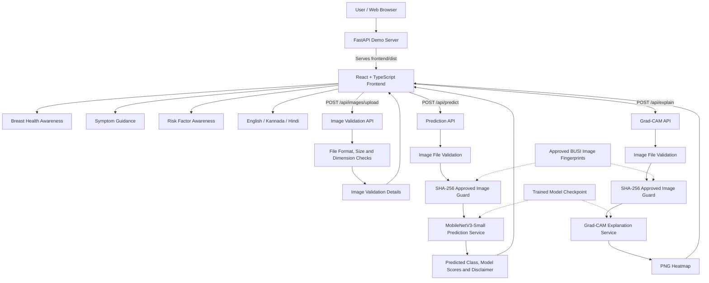

# System Architecture
## AI-Based Rural Breast Cancer Detection

### 1. Architecture Overview

The project uses a React and TypeScript frontend,
a FastAPI backend, and PyTorch-based AI services.

In local demo mode, FastAPI serves the compiled
React website and provides the API endpoints.

### 2. System Architecture Diagram

### 3. Frontend

Technology:
- React
- TypeScript
- Vite
- CSS

Features:
- Ultrasound image upload and preview
- AI prediction display
- Grad-CAM heatmap display
- Breast Health Awareness
- Breast Symptom Guidance
- Breast Cancer Risk Awareness
- English, Kannada and Hindi support
- Responsive mobile layout

The symptom guidance and risk-awareness
sections provide educational information,
not clinical diagnosis.

### 4. Backend

Framework: FastAPI

Main API endpoints:

- POST /api/images/upload
- POST /api/predict
- POST /api/explain
- GET /api/health

The backend validates uploaded file formats,
size and dimensions.

Prediction and Grad-CAM additionally check
image fingerprints against the approved
demonstration allowlist.

### 5. Artificial Intelligence

Selected model: MobileNetV3-Small

Framework: PyTorch

Input preprocessing:
- RGB conversion
- Aspect-ratio-preserving resize
- Padding to 224 x 224
- ImageNet normalization

Output classes:
- Benign
- Malignant
- Normal

The model returns research classification
scores, not clinical cancer probabilities.

### 6. Explainable AI

Grad-CAM generates a heatmap indicating
image regions influencing model predictions.

The heatmap is an explanation of model
behavior, not a verified medical finding.

### 7. Dataset and Training

Dataset: BUSI

Model-development images: 766

- Training: 536
- Validation: 115
- Testing: 115

Model training and evaluation are performed
offline using Python research scripts.

The resulting checkpoint is loaded by the
prediction and Grad-CAM services.

### 8. Privacy and Security

Implemented:
- JPG/PNG format validation
- Maximum upload size: 10 MiB
- Maximum dimensions: 20 million pixels
- SHA-256 demo-image allowlist
- Basic response-security headers
- No intentional permanent image storage
  by the prediction or Grad-CAM APIs

Limitations:
- Temporary server-side buffering may occur.
- The allowlist is not an ultrasound detector.
- Production authentication, rate limiting,
  HTTPS and broader security review remain.
- The prototype is not clinically validated.

### 9. Deployment Architecture

Development:
- React runs using the Vite development server.
- FastAPI runs on port 8000.
- Vite forwards /api requests to FastAPI.

Local demonstration:
- React is compiled into frontend/dist.
- FastAPI serves the compiled React files.
- API requests use the same server address.

Demo URL:
http://127.0.0.1:8000/

### 10. Conclusion

The architecture separates the frontend,
backend APIs, AI inference, explainability,
and educational modules.

This design supports a controlled academic
research demonstration of breast ultrasound
classification and health awareness.

It does not provide a clinically validated
breast cancer diagnosis or screening service.
