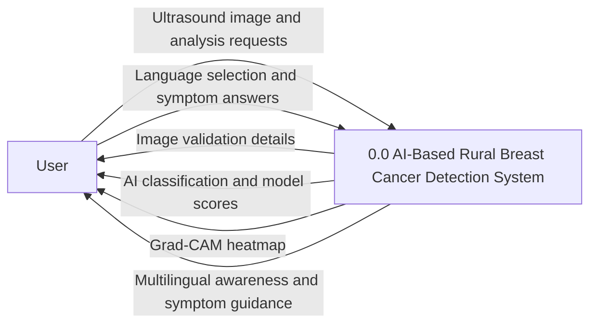
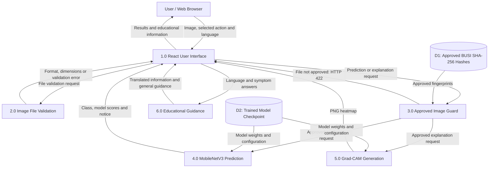

# Data Flow Diagrams (DFD)

## AI-Based Rural Breast Cancer Detection

## 1. DFD Level 0 — Context Diagram

This diagram shows the system as one process and its interactions with the user.

### Explanation

The user interacts with the research application through
a browser.

Inputs include:
- Selected ultrasound image
- Image validation and analysis requests
- Language selection
- Symptom questionnaire answers

Outputs include:
- Image file validation details
- Research classification results
- Grad-CAM explanations
- Educational breast health information
- General symptom guidance

No medical diagnosis is provided.

---

## 2. DFD Level 1 — Detailed Data Flow

This diagram divides the system into its main processes.

### Explanation

**Process 1.0 — React User Interface**

Receives the user's image, selections and requests.
Displays results, explanations and educational content.

**Process 2.0 — Image File Validation**

Checks supported format, maximum upload size,
image integrity and dimensions.

The separate upload-validation endpoint reports
file properties without performing AI analysis.

**Process 3.0 — Approved Image Guard**

Checks whether the exact file fingerprint belongs
to the approved BUSI demonstration image list.

Unapproved images receive HTTP 422.

This is not a general ultrasound detector.

**Process 4.0 — MobileNetV3 Prediction**

Uses the trained model checkpoint to generate
research classification results.

Classes:
- Benign
- Malignant
- Normal

**Process 5.0 — Grad-CAM Generation**

Generates an explanation heatmap for an approved
image using the trained model.

**Process 6.0 — Educational Guidance**

Provides:
- Breast health awareness
- General symptom guidance
- Risk factor information
- English, Kannada and Hindi content

This educational processing runs in the frontend.

### Data Stores

**D1 — Approved Image Fingerprints**

File: backend/app/core/approved_demo_sha256.txt

Contains SHA-256 fingerprints of approved BUSI
demonstration images.

**D2 — Trained Model Checkpoint**

File: artifacts/models/busi_mobilenetv3_best.pth

Contains the saved MobileNetV3-Small model
parameters and configuration.

The application does not use a persistent
patient-record database.

## 3. Privacy and Limitations

- Prediction and Grad-CAM endpoints process
  uploaded images without intentionally saving them.
- Temporary server-side buffering may occur.
- Uploaded image suitability is restricted
  through exact-file approval.
- Model scores are not validated cancer probabilities.
- Educational guidance is not medical diagnosis.

## 4. Conclusion

The Level 0 diagram represents the whole system.

The Level 1 diagram shows the internal data flow
between the frontend, image validation,
approved-image guard, AI prediction, Grad-CAM
and educational components.

This is an academic research prototype, not a
clinically validated diagnostic application.
