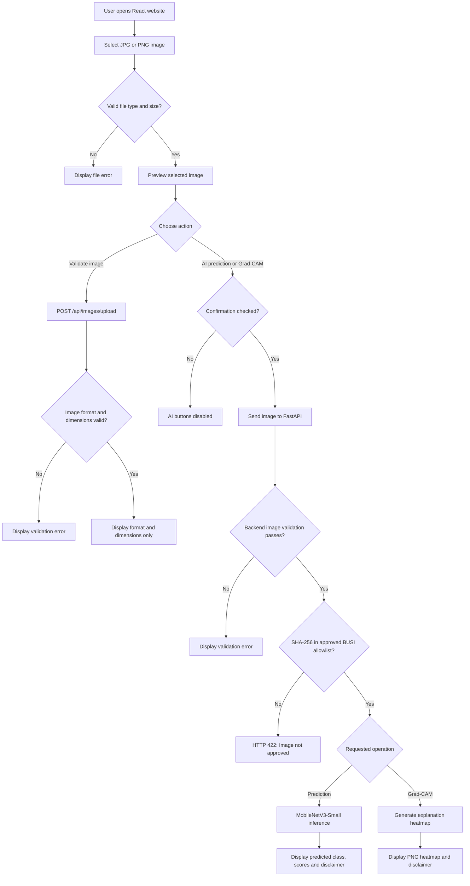

# System Flowchart
## AI-Based Rural Breast Cancer Detection

The following flowchart represents the image upload, validation, prediction and Grad-CAM workflow.

## Flowchart Explanation

1. The user selects a JPG or PNG image.
2. The frontend checks basic file type and size.
3. The user can request file-format validation.
4. AI analysis requires ultrasound confirmation.
5. The backend validates the image contents.
6. The SHA-256 guard checks membership in the approved BUSI demo-image allowlist.
7. Unapproved images receive HTTP 422.
8. Approved images can be processed by MobileNetV3-Small or Grad-CAM.
9. The website displays research outputs with medical disclaimers.

**Important:** The image allowlist identifies exact approved files. It does not independently detect breast ultrasound images or establish clinical reliability.
