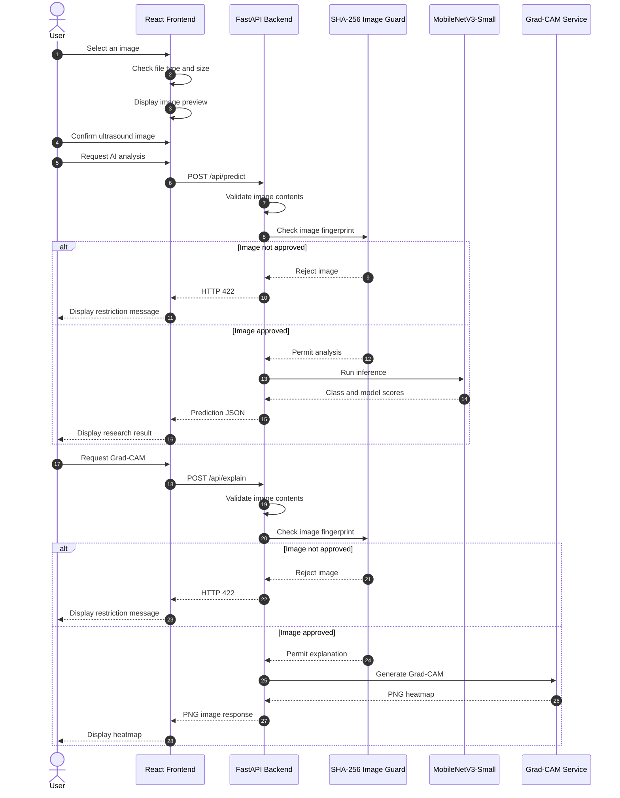

# UML Sequence Diagram

## AI-Based Rural Breast Cancer Detection

This diagram shows how the frontend and backend interact during ultrasound image analysis.

## UML Explanation

1. The user selects an image in the React interface.
2. React checks the basic file type and size.
3. The user confirms the image before requesting AI analysis.
4. FastAPI validates the uploaded image.
5. The SHA-256 guard checks membership in the approved BUSI demonstration allowlist.
6. Unapproved images receive HTTP 422.
7. Approved images can be processed by MobileNetV3-Small.
8. The prediction result contains the class and research model scores.
9. Grad-CAM uses a separate API endpoint with the same allowlist restriction.
10. The frontend displays the generated heatmap.

## Medical Limitation

This is an academic research workflow, not a clinically validated medical diagnosis system.
